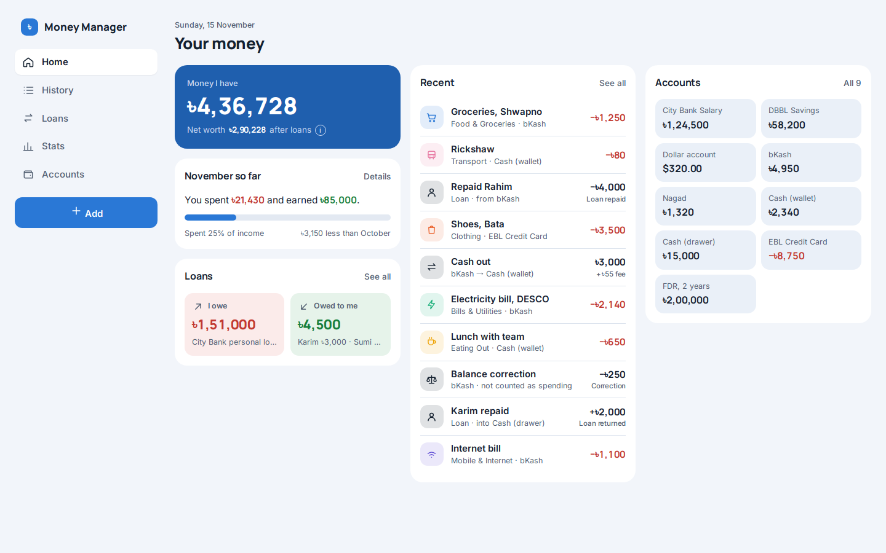
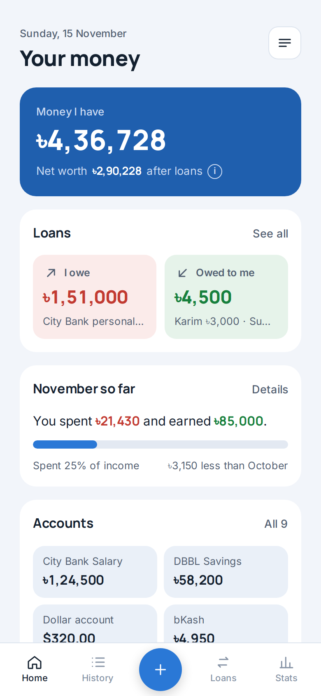
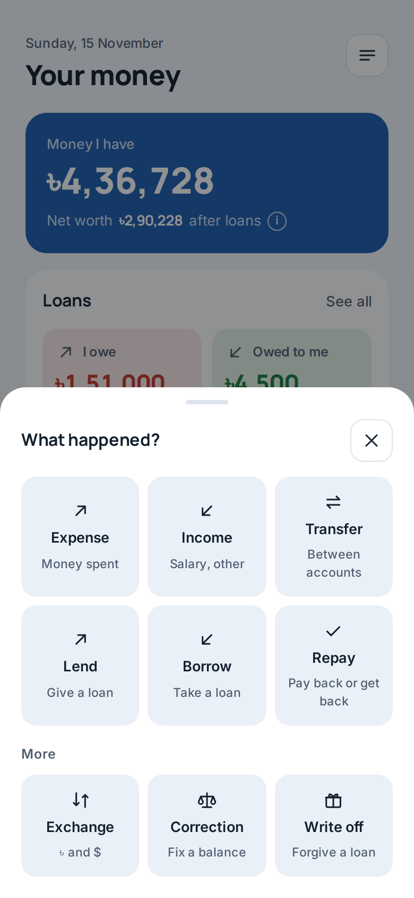
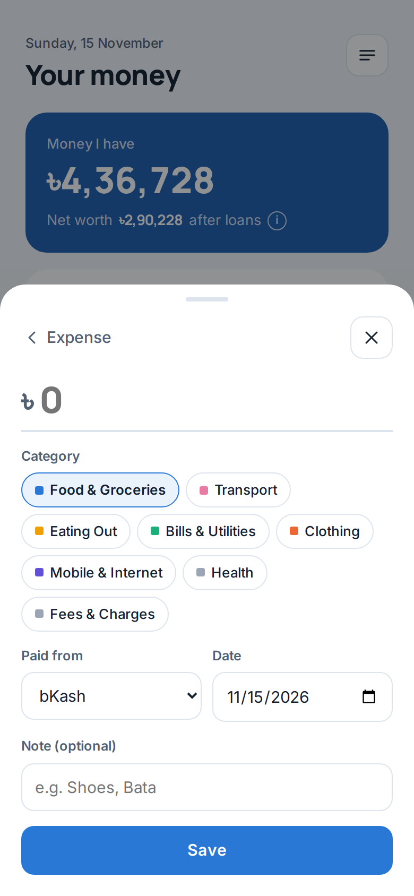
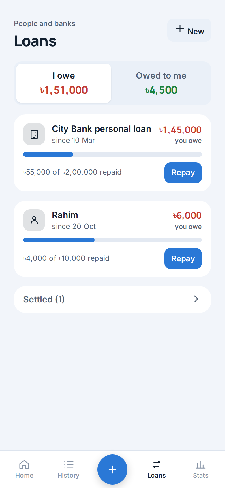
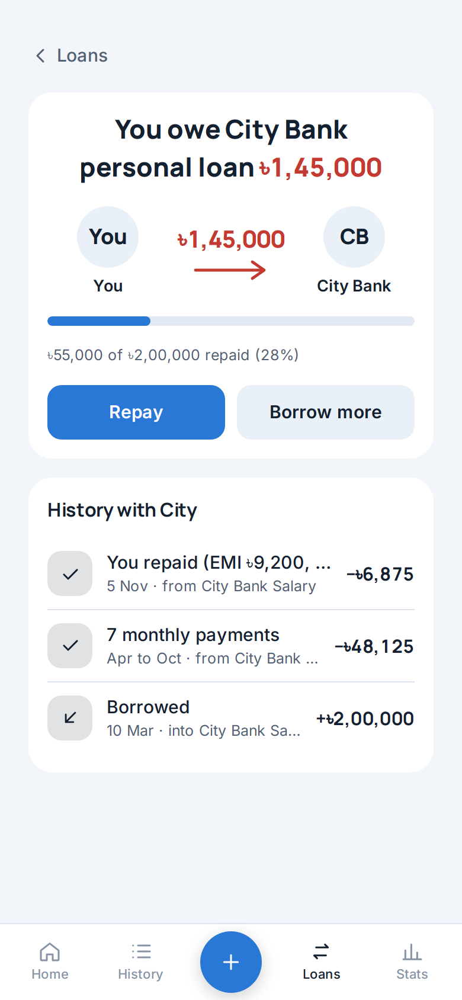
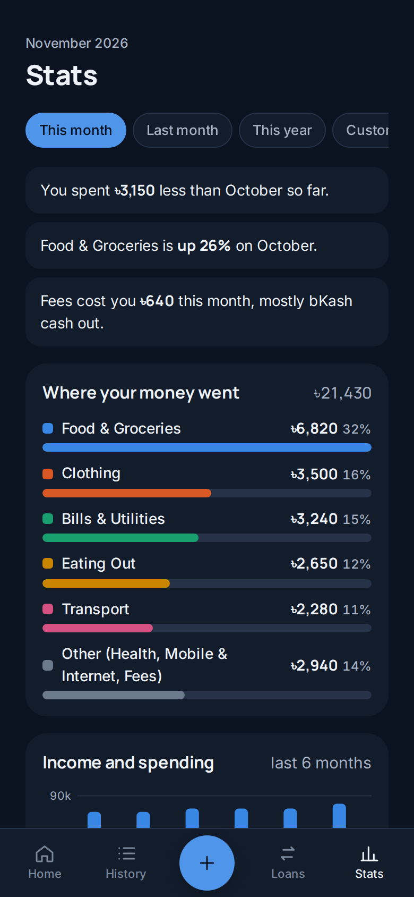
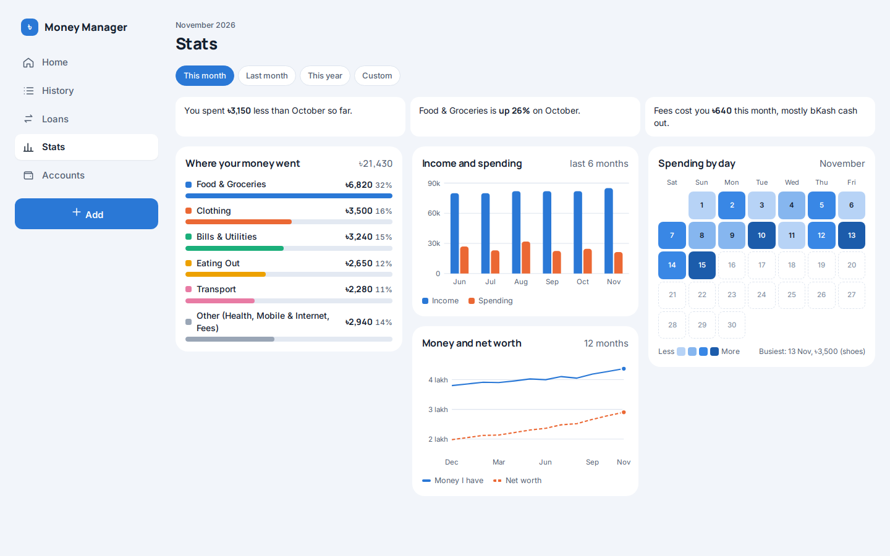
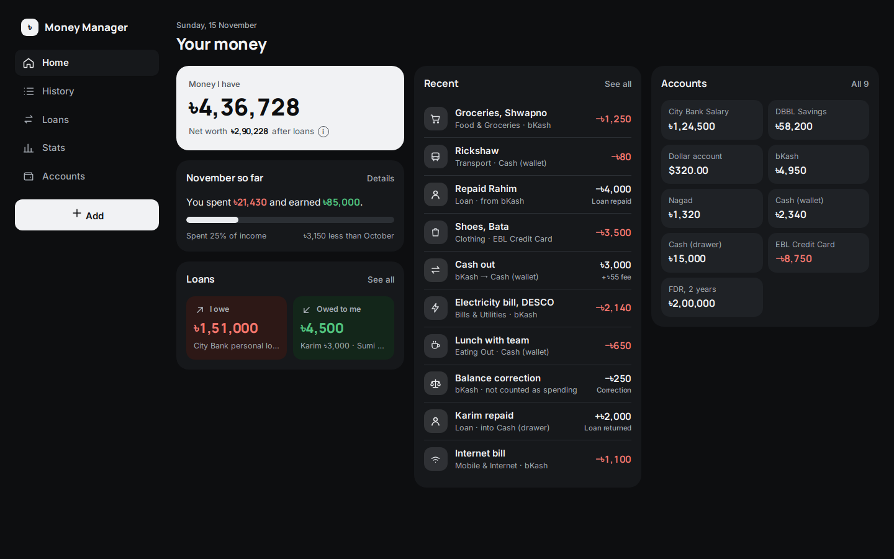
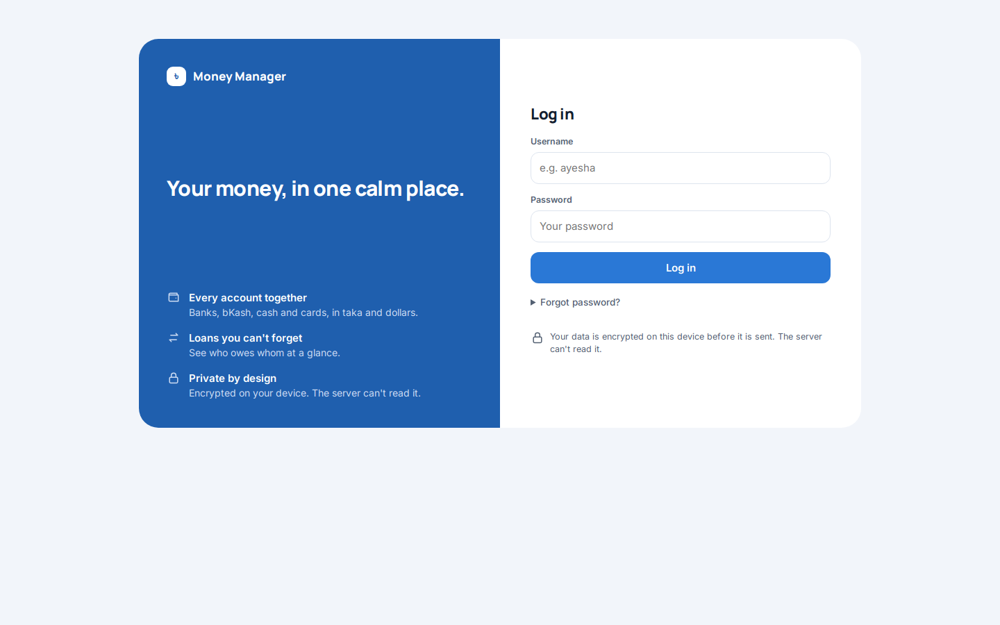

# Money Manager

**A simple, private money tracker for you and your family.** Write down what you spend and earn, see how much you have in each account, and keep track of who owes whom. It runs in the web browser on your phone or computer, on a server you own. Your data is **encrypted on your own device**, so even the server can't read it.

<p align="center">
  
</p>

> **Note:** these pictures come from the design mockup and show made-up sample data. The real app looks the same, with your own numbers.

## What you can do

- **Track every account in one place:** bank accounts, mobile wallets (like bKash or Nagad), cash in your pocket or in a drawer, credit cards, fixed deposits. Create as many as you like.
- **Record what happens in a few taps:** expenses, income, moving money between your own accounts (with any fee), and changing taka into dollars or back.
- **Never forget a loan:** lend or borrow money, then record repayments bit by bit, including partial payments, interest and forgiving what's left. Give each loan a reason ("Fridge") so two loans with the same friend are easy to tell apart; a person's loans are grouped together, and if you owe each other you can **cancel out** the amounts without any money moving. "I owe" and "Owed to me" are always shown clearly apart.
- **When a friend pays for you:** record the expense as paid by them. It counts as your spending and adds to what you owe them, without touching your accounts.
- **See where your money goes:** monthly spending by category, income against spending, how your money grows over the year, and which days you spent most, with short plain-language notes like *"Food is up 26% on October"*.
- **Add up any accounts:** pick a few accounts on the Accounts page to see what they hold together, without changing any other total.
- **Two currencies:** Bangladeshi taka (৳) is the main currency, with US dollars alongside. The dollar rate updates every day, or you can set your own.
- **Use it anywhere:** works on phones, tablets and computers, in light or dark mode, in **Colour** or **Ink** (black and white).
- **Share the server, not your data:** up to about 20 people (family or friends) can each have their own login. Each person's money is private to them (see [Privacy](#privacy-in-plain-words) for the one exception they can choose).

## Screenshots

<table>
  <tr>
    <td align="center" width="33%"><br><sub><b>Home</b>: your money at a glance</sub></td>
    <td align="center" width="33%"><br><sub><b>Add</b>: pick what happened</sub></td>
    <td align="center" width="33%"><br><sub><b>Expense</b>: amount, category, account</sub></td>
  </tr>
  <tr>
    <td align="center"><br><sub><b>Loans</b>: who owes whom</sub></td>
    <td align="center"><br><sub><b>One loan</b>: progress and history</sub></td>
    <td align="center"><br><sub><b>Stats</b>, in dark mode</sub></td>
  </tr>
</table>

<p align="center">
  
  <br><sub><b>Stats</b> on a computer: where the money went, month by month</sub>
</p>

<table>
  <tr>
    <td align="center" width="50%"><br><sub><b>Ink</b> style, dark mode</sub></td>
    <td align="center" width="50%"><br><sub><b>Login</b></sub></td>
  </tr>
</table>

## Privacy in plain words

- **Your data is locked before it leaves your device.** Amounts, notes, account names and loans are encrypted in your browser. The server only stores scrambled data it can't read, and so do its backups.
- **Your password never leaves your device.** The app turns it into two keys: one proves who you are to the server, the other unlocks your data and stays on your device.
- **If you forget your password,** each person picks one of two options when they first log in:
  - **"The admin can help me":** the admin can give you a new password and nothing is lost. The admin can also technically read your data.
  - **"Only I can recover":** only your personal recovery key (shown once, to write down) can get you back in. Nobody else can ever read your data. Lose both the password and the key, and the data is gone for good.
- **Staying unlocked:** after you unlock, the device stays unlocked for an hour after you last use it, so you don't type your password on every reload. **Lock now** in Settings ends it straight away.
- **No peeking over your shoulder:** the grand total on the Accounts page shows dots until you tap it, and you can hide any account's balance the same way. Shown amounts hide again after 30 seconds.
- **Lock Accounts with a PIN:** if friends sometimes use your phone, set a PIN at the bottom of the Accounts page. The page then asks for it every time it's opened. If you forget the PIN, your password opens it.
- **One honest limit:** the server sends the app to your browser, so you have to trust whoever runs the server not to change the app. This is true of every website.

The full design is in the [specification](docs/spec-v1.md), section 3.

## What it isn't

Money Manager is a **tracker, not a budgeting app**. It doesn't connect to banks, set budgets or send reminders. You write down what happened, and it shows you the picture. There's no app-store app: you open it in the browser and can add it to your home screen.

## Running your own copy

You need a small Linux server (1 CPU and 1 GB of RAM is plenty) with a domain name or address, and a computer with [Docker](https://www.docker.com/) to build from.

### Try it on your computer first

Everything runs inside Docker, so nothing else needs installing.

```bash
./scripts/dev.sh npm install
```

```bash
docker compose -f compose.dev.yml up backend frontend
```

Then create a login for yourself, in a second terminal:

```bash
docker compose -f compose.dev.yml exec backend npm run -w backend admin -- create-user yourname --admin
```

It prints a one-time password. Open http://localhost:5173, log in, and the app walks you through choosing your own password and adding your accounts.

### Put it on a server

The server needs Ubuntu with Docker, nginx and certbot installed, and an HTTPS certificate for your address. Then:

1. Change the address and certificate paths in [`deploy/nginx/money-manager.conf`](deploy/nginx/money-manager.conf) to your own. The file also has a block that sends visitors from a bare IP address to the domain; remove it if you don't need it.
2. Deploy from your computer, telling the script where your server is:
   ```bash
   MM_HOST=ubuntu@your-server MM_SSH_KEY=~/.ssh/your-key ./deploy/deploy.sh
   ```
   The script runs the tests, builds, uploads, installs and restarts. Your data on the server is never touched, so you can run it again for every update.
3. On the server, set the admin recovery phrase (needed for "the admin can help me"), then create logins:
   ```bash
   sudo mm-admin setup-recovery
   ```
   ```bash
   sudo mm-admin create-user ayesha --display-name "Ayesha"
   ```

Nightly backups are kept on the server for 30 days. All admin commands and checks are in [deploy/README.md](deploy/README.md).

## For developers

| Folder | What's inside |
|---|---|
| [`frontend/`](frontend/) | The web app (React + Vite). Encryption, all money calculations and the screens run here. |
| [`backend/`](backend/) | The API (Fastify + Node's built-in SQLite): logins, sessions, syncing encrypted records, dollar rates, and the `mm-admin` tool. |
| [`shared/`](shared/) | Code both sides use: the encryption module and the API's data formats. |
| [`deploy/`](deploy/) | Server setup: nginx site, Docker Compose file, backups and the deploy script. |
| [`docs/`](docs/) | The [specification](docs/spec-v1.md), the [design mockup](docs/design/) and these screenshots. |

```bash
./scripts/dev.sh npm test
```

```bash
./scripts/dev.sh npm run typecheck
```

The frontend and backend never import each other's code; they only talk over the HTTP API. The encryption uses [libsodium](https://doc.libsodium.org/) (Argon2id and XChaCha20-Poly1305).

## Status

Version 1 is finished and in daily use. Ideas for later, such as receipt photos, two-step login, sharing records with someone else, offline use, an admin screen, voice entry and use from AI tools (MCP), are listed in the [specification](docs/spec-v1.md).
